# The game

*Hai no Majutsushi - Mahjong 2* (牌の魔術師, "the tile magician") is a Japanese four-player
(riichi) mahjong for the MSX2, published by Konami in 1989 (RC-765, 128 KB). You sit at a
table against three computer players picked from eight characters of Konami's own games.
The cartridge draws everything in SCREEN 7 (512 x 212, 16 colours) and talks through the
PSG plus eight digital voices played by a DAC that lives on the cartridge.

The pictures on this page are openMSX screenshots of the cartridge running (C-BIOS MSX2),
taken with `tools/omsx_leido.tcl`; the game was left to play by itself with the space bar.

## From the title to the first hand

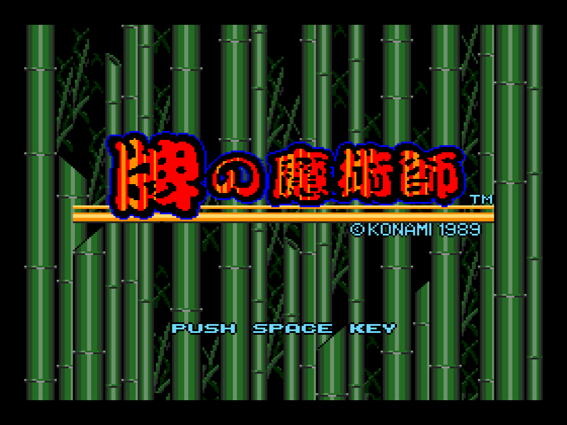

The title builds up over about ten seconds (the bamboo, then the logo, then the text), driven
by the animation of p00:5C6F. A key press leads to a two-line menu, *practice game* (練習対局)
or *real game* (実戦対局).

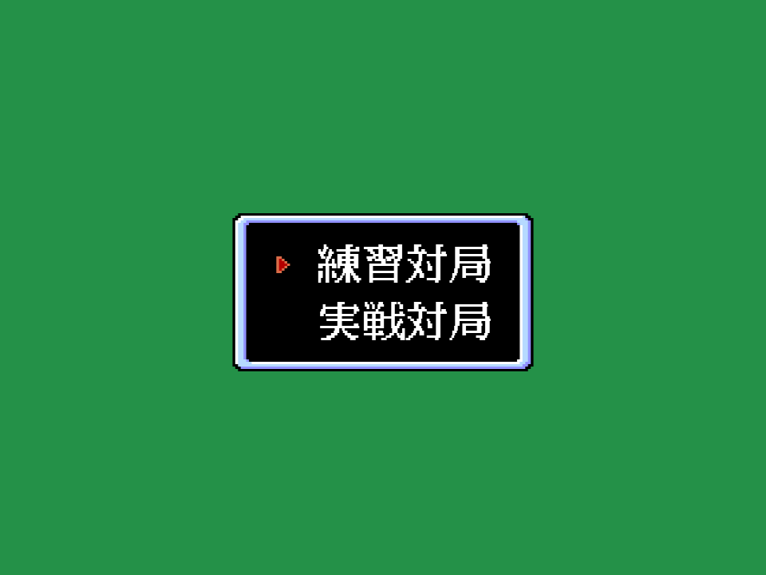

Then comes a five-line menu: personality settings (性格設定), opponent selection (面子選択),
rule settings (ルール設定), screen adjustment (画面補正) and *exit* (終了), which starts the
game. The rules are on [The rules](THE-RULES.html) and the personalities on
[The rivals](THE-RIVALS.html).

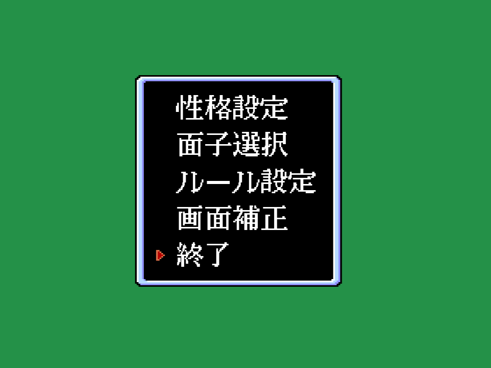

The three rivals appear one by one, each in a framed portrait, and the dice are rolled to
see who deals (the East wind, 東).

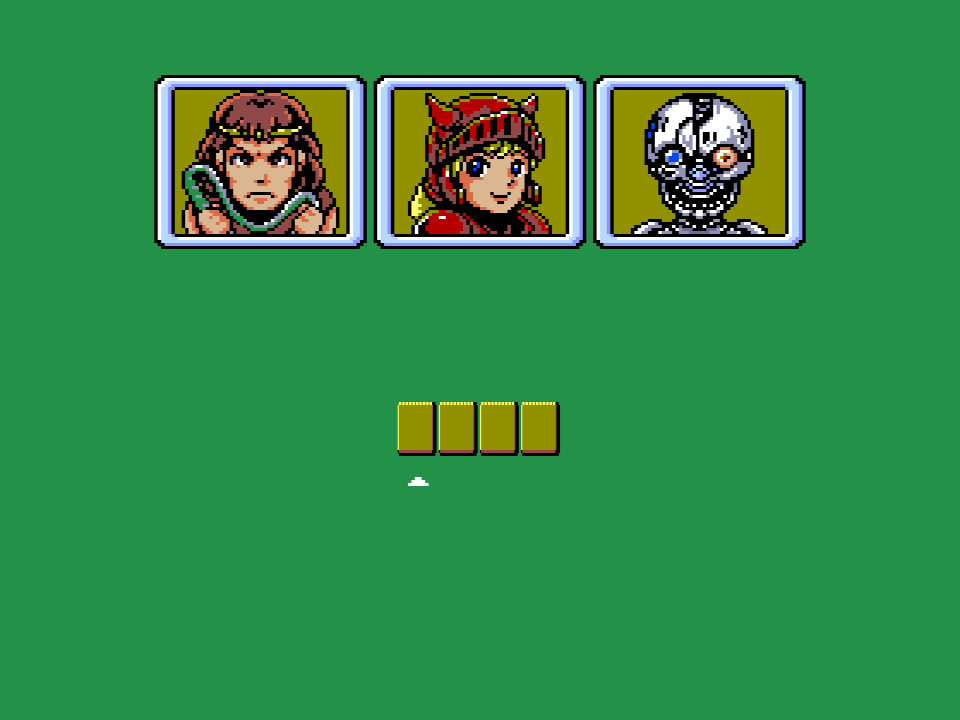

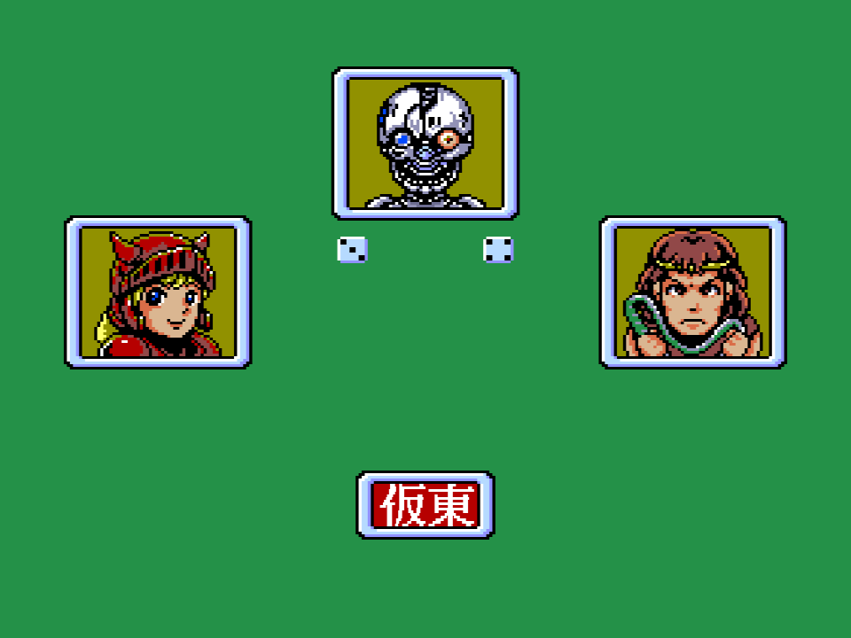

## The table

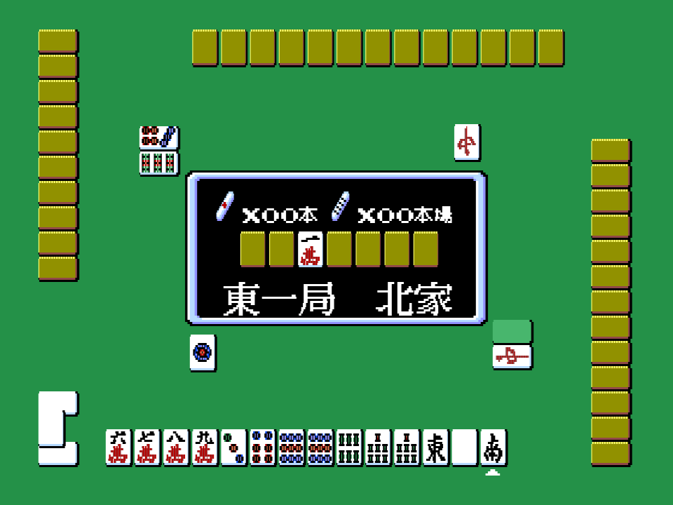

The four hands are on the four sides of the table, with the wall in the middle and the score
panel on top of it (round, honba and riichi counters, dealer). Discards pile up in front of each
player. The human player (always seat 0) picks the tile to throw with the cursor keys and the
space bar.

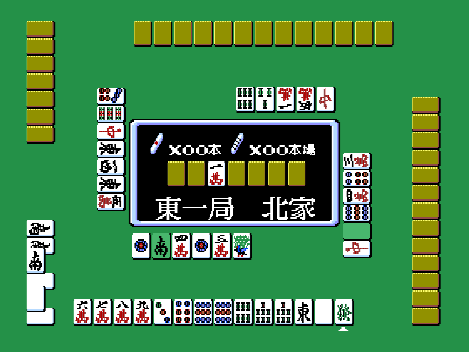

When a discard allows a call the game opens a small box with the options, and the rival that
calls shows its portrait with the shout (PON!, CHI!, KAN!, RON!):

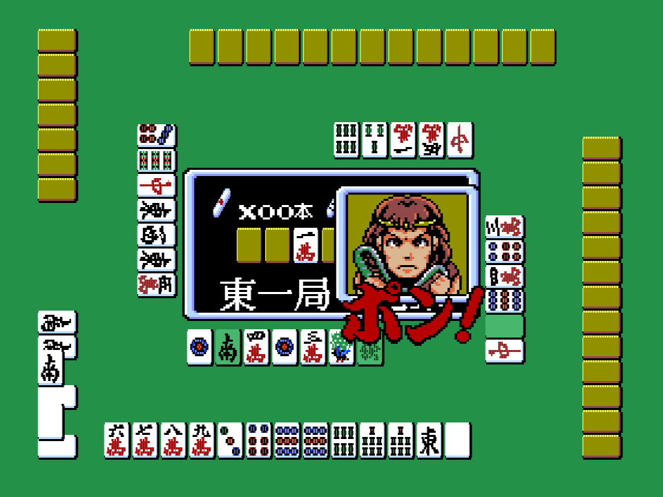

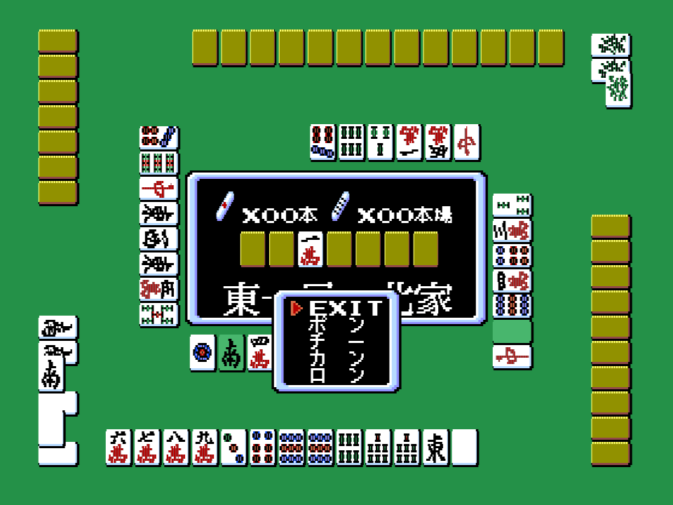

## The end of a hand

A hand ends with a win by self-draw (*tsumo*), a win on a discard (*ron*) or an exhaustive draw
(*ryuukyoku*, 流局), and the game shows the payments.

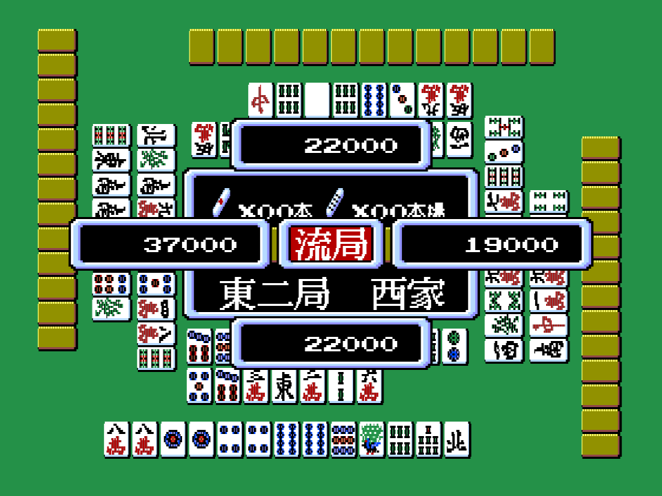

When somebody wins, the list of yaku appears, one line per yaku with its value in *han*, and the
fu:

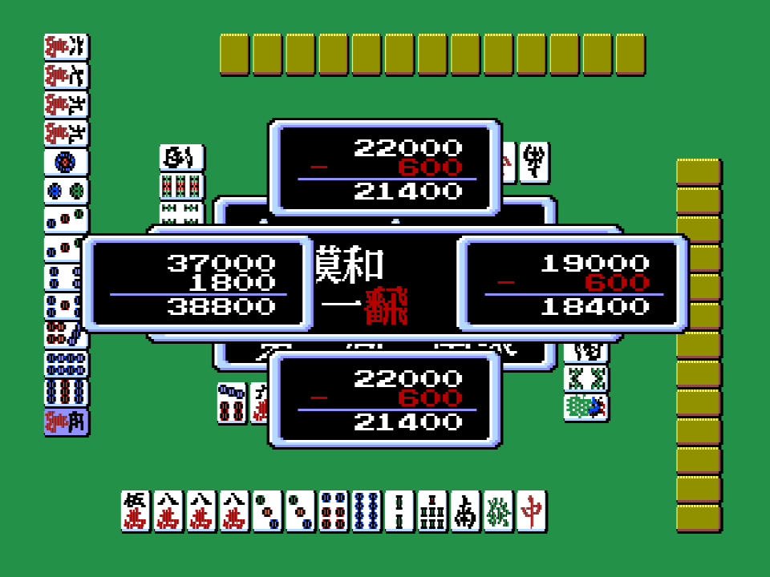

The code behind each screen is in [Under the hood](UNDER-THE-HOOD.html); the yaku are on
[The yaku](THE-YAKU.html).

## Animated

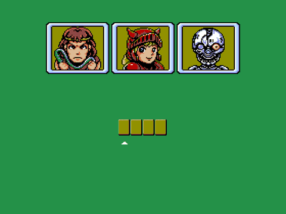

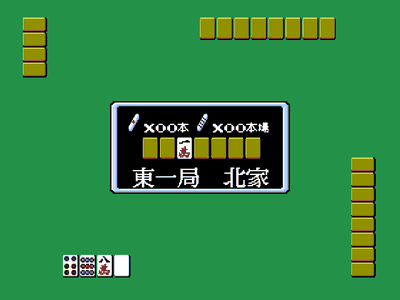
