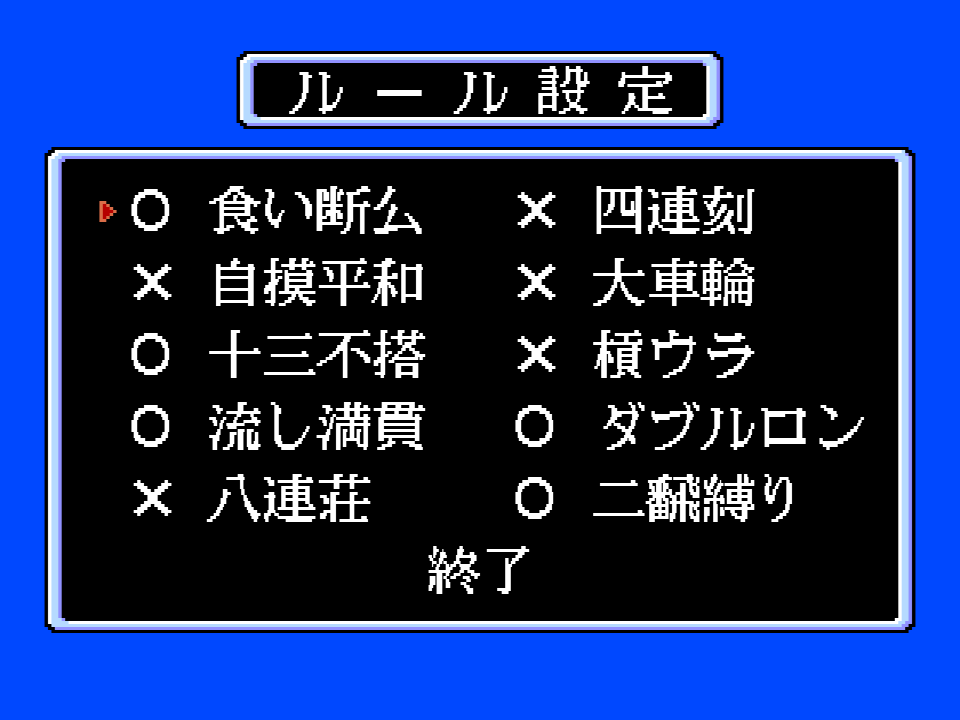

# The rules

The *rule settings* screen (ルール設定) holds ten on/off options. They live in ten bytes
at 0xC020-0xC029, copied at start from the table at p15:A19C (`01 00 01 01 00 00 00 00 01 01`),
which is exactly the state the screen shows:

| byte | rule | default | read at |
|---|---|---|---|
| 0xC020 | 食い断幺: tanyao allowed with an open hand | yes | p04:A431 |
| 0xC021 | 自摸平和: pinfu counts with a self-draw | no | p04:A3B6 |
| 0xC022 | 十三不搭: the thirteen unconnected tiles | yes | p01:70E4 |
| 0xC023 | 流し満貫: nagashi mangan | yes | p01:7087 |
| 0xC024 | 八連荘: eight consecutive wins by the dealer | no | p01:6D02 |
| 0xC025 | 四連刻: four consecutive triplets | no | p04:A212 |
| 0xC026 | 大車輪: seven consecutive pairs of one suit | no | p04:A24F |
| 0xC027 | 槓ウラ: dora under the kan | no | p04:A8BE |
| 0xC028 | ダブルロン: double ron | yes | p01:6510 |
| 0xC029 | 二翻縛り: at least two han | yes | p01:6963 |

p03:A803 runs the screen: the cursor moves with the four directions, the button toggles
the option under it and the last line (終了) leaves.
