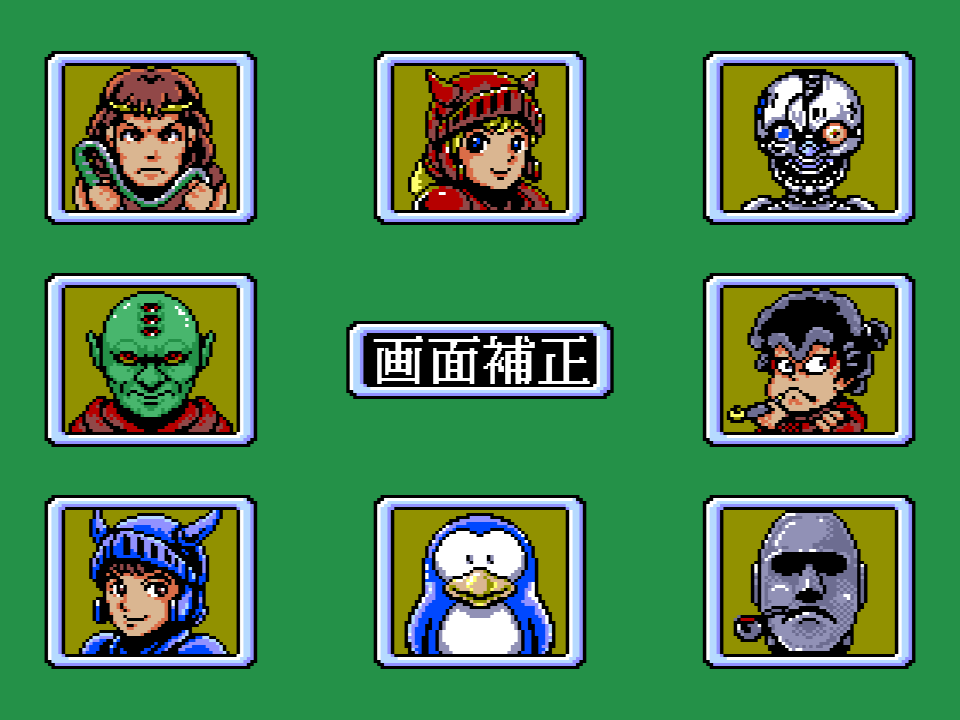
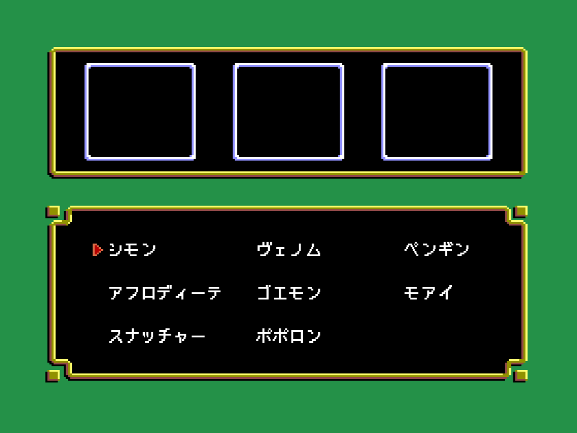
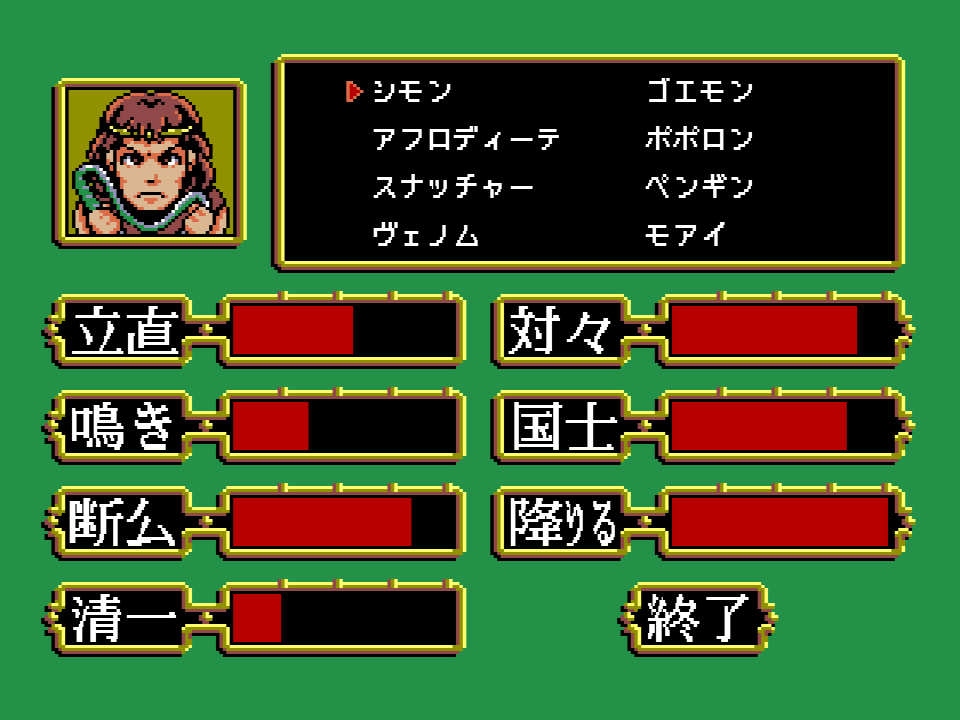

# Los rivales

Juegas siempre en el asiento 0 contra tres jugadores de la máquina elegidos entre ocho personajes de los
propios juegos de Konami, en el orden en que salen en la pantalla de elección de rivales (面子選択):

| nº | personaje |
|---|---|
| 1 | シモン (Simon) |
| 2 | アフロディーテ (Afrodita) |
| 3 | スナッチャー (Snatcher) |
| 4 | ヴェノム (Venom) |
| 5 | ゴエモン (Goemon) |
| 6 | ポポロン (Popolon) |
| 7 | ペンギン (el pingüino) |
| 8 | モアイ (el moai) |

## Siete contadores por personaje

Cada personaje tiene siete números de 0 a 63 (0x3F), que la pantalla de personalidad (性格設定) enseña como
barras rojas:

| contador | rótulo | qué hace el código con él |
|---|---|---|
| 0 | 立直 (riichi) | sube cuando una mano ganada por el humano lleva riichi (yaku 0x01) |
| 1 | 鳴き (llamadas) | sube cuando la mano ganadora está abierta (p03:BDCF) |
| 2 | 断幺 (tanyao) | sube con tanyao (yaku 0x05), baja con chanta (0x12) |
| 3 | 清一 (chinitsu) | sube con honitsu o chinitsu (0x19, 0x1B) |
| 4 | 対々 (toitoi) | sube con toitoi o siete parejas (0x0E, 0x0D) |
| 5 | 国士 (kokushi) | sube con kokushi (0x28) |
| 6 | 降りる (retirarse) | se mueve según quién ha ganado |

Los valores de partida son ocho filas de ocho bytes en p15:A00C y coinciden con las barras de la
pantalla (la fila de Simon, `35 22 52 14 54 51 63`, es el 56 %, 35 %, 83 %, 22 %, 86 %, 81 % y 100 % de la barra):

| nº | riichi | llamadas | tanyao | chinitsu | toitoi | kokushi | retirarse |
|---|---|---|---|---|---|---|---|
| 1 | 35 | 22 | 52 | 14 | 54 | 51 | 63 |
| 2 | 16 | 63 | 4 | 52 | 44 | 2 | 5 |
| 3 | 63 | 1 | 42 | 19 | 11 | 36 | 30 |
| 4 | 5 | 35 | 18 | 44 | 31 | 19 | 47 |
| 5 | 30 | 36 | 0 | 2 | 33 | 2 | 34 |
| 6 | 35 | 31 | 33 | 38 | 41 | 16 | 21 |
| 7 | 50 | 8 | 35 | 63 | 20 | 2 | 52 |
| 8 | 3 | 52 | 51 | 21 | 30 | 53 | 1 |

Al empezar una partida p15:A04C copia los ocho bytes de cada rival elegido a su mano (desplazamiento +0x90).
Durante la partida los contadores no son fijos: tras una mano ganada por el humano p03:BD8E recorre la lista
de yaku (0xC2E0) y mueve los contadores de los otros jugadores, hasta 0x3F, de modo que la máquina se
va hacia el estilo contra el que acaba de perder. Los mismos contadores gobiernan a p15:A0B5 (qué palo
guarda la máquina), p15:A108 (cuándo pide fichas) y p15:A14C (cuánto le gusta cantar).

El análisis de mano que usa la máquina está en p01:72D2-7FFF: reparte las 13 fichas por palos, busca
escaleras, parejas, huecos y parejas de borde (listas en los desplazamientos +0x160 a +0x1B0 de la mano)
y busca las combinaciones en una tabla de patrones del banco 15 (p15:A306).
