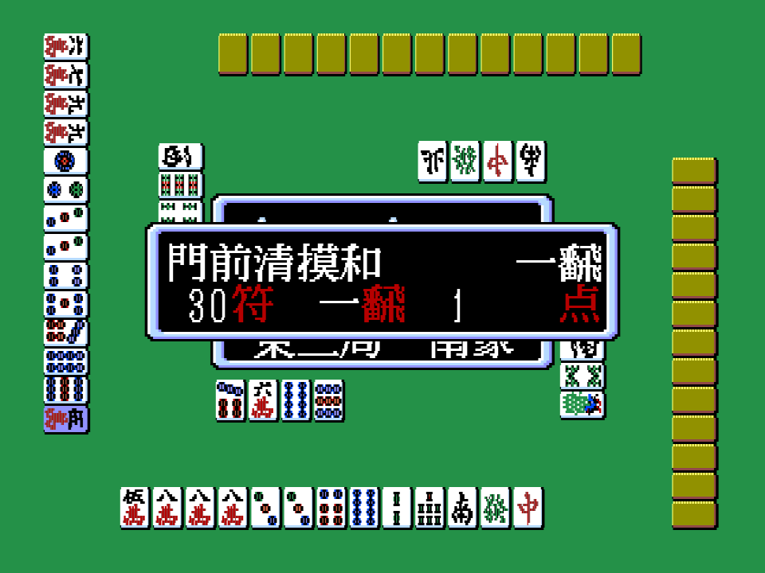

# Los yaku

Cuando una mano gana, el juego monta una lista de yaku en 0xC2E0: 32 pares de bytes (código, valor) que
p01:6CD5 rellena llamando a 32 pequeñas comprobaciones del banco 4 (la tabla de p01:716B, más 20 en
p01:71A5). p04:A341 añade un par; el valor es el número de *han*, o 0x81, 0x82 o 0x83 para una mano
límite (una, dos o tres veces). La pantalla escribe luego cada nombre con sus han:

Esa pantalla es el cotejo de la primera fila de la tabla: el código 0x04 es 門前清摸和 (*menzen tsumo*),
que vale un han.

## Cómo se establecieron los códigos

`tools/prueba_yaku.py` ejecuta el análisis del propio cartucho (un emulador de Z80 con el mapper) sobre una
mano escrita a mano en la RAM y lee la lista; `work/yaku_azar.py` lo hizo con 6.000 manos ganadoras al
azar. Cada código marcado *medido* salió con una mano que tiene exactamente ese yaku (unos cuantos están
clavados en `tests/test_cartucho.py`). Los nombres son los japoneses estándar; el juego los dibuja en
kanji. Los marcados *leído* no salieron con manos al azar y se nombraron por lo que comprueba su rutina.

| código | yaku | han | cómo |
|---|---|---|---|
| 0x01 | 立直 riichi | 1 | medido |
| 0x02 | riichi + 一発 ippatsu | 2 | leído (p04:A350) |
| 0x03 | 平和 pinfu | 1 | leído (p04:A3AD) |
| 0x04 | 門前清摸和 menzen tsumo | 1 | medido, en pantalla |
| 0x05 | 断幺九 tanyao | 1 | medido |
| 0x06 | 一盃口 iipeikou | 1 | medido |
| 0x07 | 役牌 yakuhai | uno por triplete | medido |
| 0x08 | 嶺上開花 rinshan kaihou | 1 | leído |
| 0x09 | 海底摸月 haitei | 1 | leído |
| 0x0A | 河底撈魚 houtei | 1 | leído |
| 0x0B | 槍槓 chankan | 1 | leído |
| 0x0C | doble riichi | 2 | leído |
| 0x0D | 七対子 chiitoitsu | 2 | medido |
| 0x0E | 対々和 toitoi | 2 | leído |
| 0x0F | 二盃口 ryanpeikou | 2 | medido |
| 0x10 | 一気通貫 ittsu | 2 cerrada, 1 abierta | medido |
| 0x11 | 三色同順 sanshoku doujun | 2 cerrada, 1 abierta | medido |
| 0x12 | 混全帯幺九 chanta | 2 cerrada, 1 abierta | medido |
| 0x13 | 三暗刻 sanankou | 2 | medido |
| 0x14 | 三槓子 sankantsu | 2 | leído |
| 0x15 | 三連刻 sanrenkou | 2 | medido |
| 0x16 | 三色同刻 sanshoku doukou | 2 | medido |
| 0x17 | 小三元 shousangen | 2 | medido |
| 0x18 | 混老頭 honroutou | 2 | leído |
| 0x19 | 混一色 honitsu | 3 cerrada, 2 abierta | medido |
| 0x1A | 純全帯幺九 junchan | 3 cerrada, 2 abierta | medido |
| 0x1B | 清一色 chinitsu | 6 cerrada, 5 abierta | medido |
| 0x1C | ドラ dora | uno por ficha | medido |
| 0x1D | doble riichi + ippatsu | 3 | leído |

Manos límite (valor 0x81 salvo que se diga):

| código | yaku | cómo |
|---|---|---|
| 0x20 | 四暗刻 suuankou | medido |
| 0x22 | 大三元 daisangen | medido |
| 0x23 | 小四喜 shousuushii | medido |
| 0x24 | 字一色 tsuuiisou | medido |
| 0x25 | 清老頭 chinroutou | leído |
| 0x26 | 緑一色 ryuuiisou (2, 3, 4, 6, 8 de bambú y el dragón verde) | leído |
| 0x27 | 九蓮宝燈 chuuren poutou | leído |
| 0x28 | 国士無双 kokushi musou | leído |
| 0x29 | 天和 tenhou | leído |
| 0x2A | 地和 chiihou | leído |
| 0x2B | 人和 renhou (ron antes de cualquier descarte) | medido |
| 0x2C | cuatro tripletes seguidos (opción 0xC025) | leído |
| 0x2D | 大車輪 siete parejas seguidas (opción 0xC026) | leído |
| 0x2F | 十三不搭, valor 0x83 (opción 0xC022) | leído |
| 0x30 | suuankou con espera de pareja, valor 0x82 | medido |
| 0x31 | kokushi con espera de trece fichas, 0x82 | leído |
| 0x32 | 大四喜 daisuushii, 0x82 | leído |
| 0x33 | chuuren poutou con espera de nueve fichas, 0x82 | leído |
| 0x34 | ocho victorias seguidas (opción 0xC024) | leído |
| 0x35 | la penalización de la página siguiente, valor 0x83 | leído |

Los fu los calcula p15:A1A6 (20 o 30 de entrada, 10 por ron cerrado, 2 por robo, por cada triplete y cada kan, y
por la espera), y el pago p04:ACB4, que además suma los honba (100 cada uno) y las varillas de riichi (1.000 cada una).
